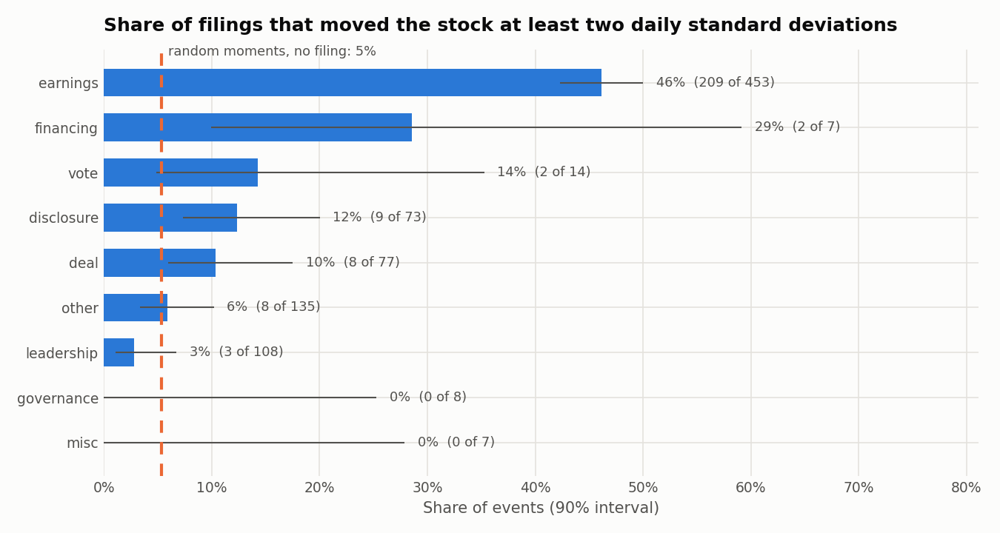
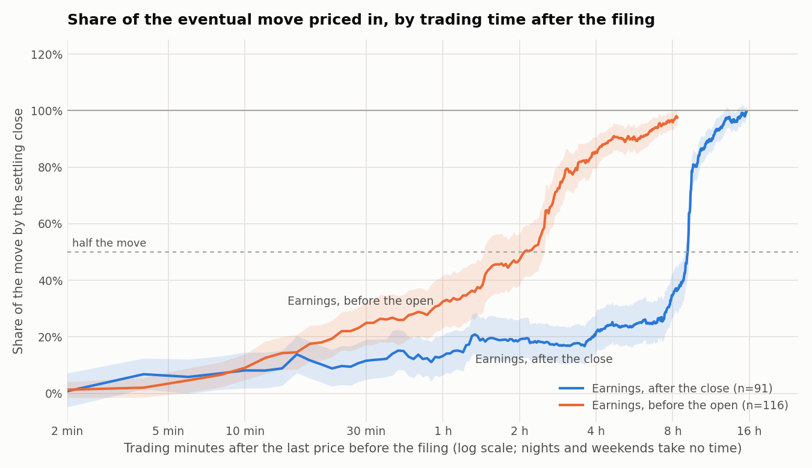
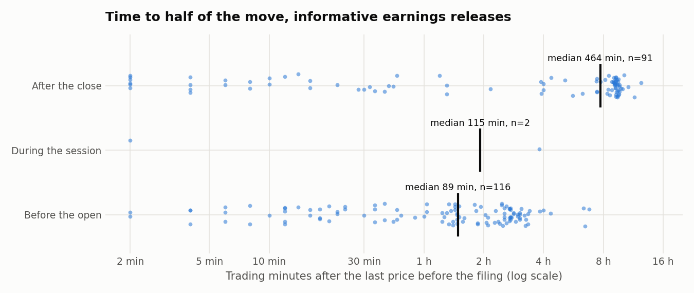
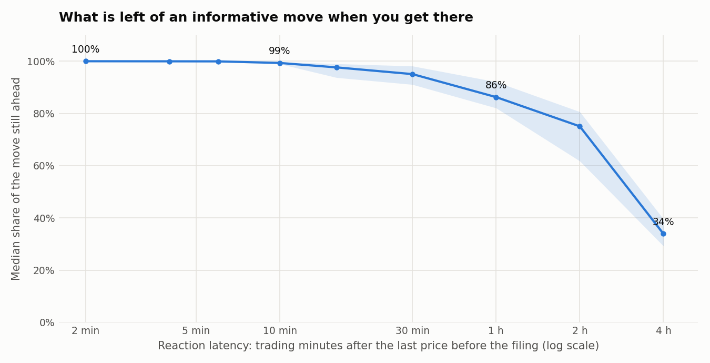

# Halflife

How fast is public news priced into a stock, and is anything left to trade once you see it?

Halflife measures the first question for every 8-K filed by an S&P 500 company over six weeks of the Q3 2026 earnings season, at 2-minute resolution, including pre- and post-market trading. It tests the second with walk-forward models and a set of stress tests, and it keeps answering both live: it watches the SEC for new filings, makes a timestamped prediction for each one, and scores it after the close in a hash-chained ledger that cannot be edited after the fact.

| | |
|---|---|
| Filings measured | **882** 8-K events from 476 companies, Oct 6 to Nov 16, 2026, plus 1,497 placebo moments with no filing |
| Earnings released after the close | half the move is in after a median **464 trading minutes**: around 8 the next morning |
| Earnings released before the open | half the move is in after a median **89 trading minutes** |
| The regular open | its first two minutes add **a quarter** of an earnings release's entire move (23% to 25%, median) |
| Trading the first reaction | following the move 4 minutes after an earnings filing **lost 63 bps** on average before costs (90% interval: -108 to -18) |
| A tradable edge after the open | **not established**: counting each trading day once, the best rule's out-of-sample t falls from 2.6 to 0.2, and the one model that made money falls from 2.1 to 1.5. Both are now scored live |

None of this is investment advice. Nothing here places orders.

## The question, made measurable

"How fast is information incorporated" needs three things pinned down before it means anything.

**When the information arrived.** An 8-K's acceptance time is recorded by the SEC to the second. It is the most precisely timed corporate news there is, so it is the clock everything is measured against. (It is not always the first public moment: a company can put a press release on the wire minutes before it files. The study measures the hour before each filing to see whether that happened. For the median earnings release, it did not.)

**What counts as time.** US stocks trade from 04:00 to 20:00 Eastern. Measured on the wall clock, a filing at 16:05 would look slow just because the market sleeps overnight. Halflife measures in trading minutes on a 2-minute grid of the extended session, on which nights and weekends take no time.

**Where the price ends up.** Each event's total move is its market-adjusted return from the last price before the filing to the first regular-session close that gives the news time to settle: the same day's close for a filing before 15:00, otherwise the next trading day's. The path toward that close, divided by the total, is the share of the news priced in at each moment. The time it first reaches 50% is the event's half-life.

A move only has a half-life if there was a move. An event counts as informative when its total move is at least two of the stock's daily standard deviations, using volatility from the 20 sessions before the event and nothing after it.

Each company is measured once. Alphabet, Fox and News Corp have two share classes in the index, so the S&P 500's 503 tickers are 500 companies; for those three, the more liquid class is used, chosen from trading before the window.

## What the measurements say

### Most 8-Ks are not news. Earnings are.



To check the threshold, the study also measures 1,497 random moments with no filing within two trading days. 5.3% of them clear it anyway (90% interval: 4.5% to 6.4%). That is the false-positive rate. Earnings releases clear it 46% of the time. Executive changes (3%) and routine "other events" (6%) look like random moments, and deals do only a little better (10%, from 77 filings). By price, most material-event filings are not surprises.

### After-hours trading prices earnings slowly. The open does the work.



For the 91 informative earnings releases filed after the close, a median of 6% of the move is in after an hour of after-hours trading and 37% by the next morning's open. Then the first two minutes of the regular session add 23% at once. For the 116 released before the open, 20% is in by the open and the first two minutes add 25%.



After-close releases split into two groups. Some are priced within minutes in after-hours trading. Most wait for the next open, which is why the median half-life lands around 8 the next morning.

Two things these numbers do not say:

- That markets are slow to read a filing. An earnings call usually starts 30 to 60 minutes after the release and adds information; the half-life is that of the whole news episode the filing starts.
- That after-hours prices are wrong. Thin trading moves prices on few trades. Large after-hours moves were often in the wrong direction at first: one stock rose 5% in the first ten minutes, then finished the next day 22% lower relative to the market.

### What is left for a late trader



Of an informative earnings move, a median 99% is still ahead ten minutes after the filing, 86% after an hour, and 34% after four hours of trading time. "Ahead" assumes you know the direction. Without that knowledge, trading in the direction of the move so far lost money on average at every latency measured. At 4 minutes after an earnings filing, it lost 63 bps on average before costs. Early reactions overshoot often enough that following them is a losing rule.

## Can anything be predicted? Not reliably, yet.

The models ask one question: given what is known at the decision time, will the move so far continue to the settling close, or reverse? The probability is the confidence, and a fixed rule turns it into a stance: with the move at 0.55 or above, against it at 0.45 or below, otherwise stand aside. Each stance pays a round-trip cost: 10 bps in the regular session, 30 bps in extended hours.

Evaluation is walk-forward by calendar week. Each week is predicted by models trained only on events whose outcome was already known before that week began. A test shows that two opposite futures give identical features: nothing after the decision time can reach them. Returns are tested twice: per trade, and per trading day, because filings decided on the same morning share that morning's market and are not independent bets.

**Ten minutes after the filing.** 169 filings had moved their stock at least half a daily standard deviation by then; 56 could be tested out of sample. No model had skill (AUC 0.47 to 0.50), and every model and rule lost money after costs. The 10-minute mark is too early: the study shows almost nothing is priced in yet.

**Right after the regular open, for filings released before it.** The study says the open is where the price is found, so this is the second decision point: 526 events, 374 out of sample across four weeks ([results/model/findings.md](results/model/findings.md)).

- Logistic regression had no skill (AUC 0.47) and lost money.
- The simplest rule, always go with the opening move and hold to the close, earned **+45.9 bps per trade after costs, t = 2.60**.
- Gradient boosting ranked events a little better than chance (AUC 0.535) and its stances earned **+40.8 bps per trade, t = 2.06**. Its probabilities were too extreme to use as confidences: when it said 0.79, the move continued 56% of the time.

Each got a stress test. The rule has nothing fitted, so it can be tested on all 526 events ([rule_robustness.csv](results/model/at_open/rule_robustness.csv)):

| Check | Go with the opening move |
|---|---|
| All 526 events, mean net of 10 bps | +17.5 bps, 90% interval -6.6 to +40.5 |
| Median trade | -0.4 bps |
| Counting each trading day once | t = -0.75 (out-of-sample events only: 0.19) |
| By week | positive in 3 of 7: the two busiest of the earnings season, and Nov 16, a single day |
| Outside those two weeks | -53.2 bps per trade over 192 events (90% interval -85 to -23) |
| At 20 or 30 bps of cost | +7.5 and -2.5 bps |

Gradient boosting is fitted, so only its out-of-sample weeks count ([boosting_breakdown.csv](results/model/at_open/boosting_breakdown.csv), [boosting_neighbors.csv](results/model/at_open/boosting_neighbors.csv)):

| Check | Gradient boosting |
|---|---|
| Counting each trading day once | t = 1.53, over 16 trading days |
| By week | positive in all four: +52, +38, +6 and +26 bps per trade (the last week is one day) |
| At the 18 nearby settings of depth, learning rate and rounds | 11 reach t of 2 per trade; per trading day, the median is 1.8 |
| Where the money came from | going with the move: +73.7 bps over 193 trades; going against it: -19.2 bps over 106 |

The rule's t of 2.6 is what two busy weeks look like: once each day counts once, nothing is left. Gradient boosting holds up better, and steadily across nearby settings. Its gain comes from choosing which opening moves to follow, not from fading them. But four weeks, 16 trading days, a per-day t of 1.5 and ten strategies tried across two decision points do not make an edge. Six weeks of data show no reliable edge after the open; they show one candidate worth watching.

## Live: a record that cannot be edited

The two results that weakened under scrutiny are exactly what a live test is for. Both are fixed in policy v2, [results/model/policy.json](results/model/policy.json), timestamped before the runner made any decision.

`halflife live` polls the SEC's search index every 20 seconds during trading hours. When an S&P 500 company files an 8-K, it looks up the exact acceptance time and records the detection, with its latency. Then:

- **Ten trading minutes in:** the logistic model's probability and stance, kept as a control: it had no skill in the backtest.
- **After the open's first bar, for filings released before it:** two stances, scored side by side. The rule's (with the move), with its confidence: the historical continuation rate for that kind of filing, with an interval, 53.7% (49.3% to 58.0%) for earnings from 352 events. It is deliberately not a model output. And gradient boosting's probability and stance.
- **After the settling close:** the outcome, net of costs, for each stance.

A filing that has not moved its stock is recorded as skipped. A decision more than ten minutes late is also skipped, not made. The runner ignores everything filed before it first started.

Every entry goes into [results/ledger.jsonl](results/ledger.jsonl) with the hash of the entry before it. Changing, deleting or reordering any past entry breaks every hash after it (`halflife verify-ledger`), and tests show each of those forgeries being caught. Committing the ledger to git before outcomes are known adds an outside timestamp.

The record started on Nov 17, 2026, under policy v1. Twenty minutes later, before any decision, a check found that v1 had been fit on data that counted 38 filings twice: one 8-K from Alphabet, Fox or News Corp had been measured once per share class. Removing those duplicates, under 3% of the data, moved gradient boosting's out-of-sample t from 0.78 to 2.06 and the rule's from 2.78 to 2.60. The ledger's second entry records the switch to v2 and why; nothing in it was rewritten. A backtest that sensitive is one more reason to judge these strategies by the live record. It is far too young to say anything yet; it exists so that in a few months it can.

## The radar

`halflife radar` lists what is scheduled. It shows the next FOMC statements, from the Fed's calendar. It shows S&P 500 earnings for the coming week, from Nasdaq's calendar, with whether each comes before the open or after the close, and what such releases did in the study. It also lists upcoming IPOs. The latest output is in [results/radar.md](results/radar.md).

Only one FOMC statement fell inside the 2-minute data window (Oct 28). SPY was up 14 bps by the close and half of that was in after 36 minutes. With n = 1 that is an illustration, not a finding.

## Run it

```bash
pip install -e ".[test]"
halflife ingest      # S&P 500 list, 8-K filings, 2-minute and daily bars (about 2,000 paced requests)
halflife study       # measure every filing, write results/study and the figures
halflife model       # walk-forward evaluation, stress tests, live policy
halflife radar
halflife live        # runs until stopped with Ctrl-C; results/ledger.jsonl
halflife verify-ledger
pytest
```

The SEC asks automated clients to identify themselves. Set `HALFLIFE_SEC_USER_AGENT` to your name and email to do so. Without it, the SEC serves the filing metadata this project uses, but not the filing documents.

## Tests

43 tests, all passing. They cover:

- the trading clock, including that nights and weekends take no time and that the grid never sees a later trade;
- recovery of known half-lives from synthetic paths, with and without noise;
- point-in-time features: two opposite futures give identical features;
- walk-forward folds that never train on an outcome from after the fold began;
- one share class per company, so no filing is measured twice;
- the ledger catching an edit, a careful re-hash, a deletion and a reordering, and recording a change of models exactly once;
- every parser, run against recorded responses.

## Limits

- **One earnings season, six weeks.** Yahoo serves 2-minute bars, with extended hours, for about six weeks. Every conclusion here is about Q3 2026.
- **Bars, not quotes.** Yahoo reports no volume for pre- and post-market bars, and a bar is a last trade, not a bid or offer. Costs are assumptions: 10 and 30 bps round trip.
- **Filings, not wires.** A press release can precede its 8-K; the hour before each filing is measured to show when it did. Conference calls and analyst notes after a filing are part of what the half-life measures.
- **Today's S&P 500.** Membership is taken as of the run. Over six weeks, the effect is negligible.

## Layout

```text
halflife/clock.py       the trading clock: 2-minute steps over 04:00 to 20:00 Eastern, nights take no time
halflife/diffusion.py   an event's path, its half-life, and what share is in at each checkpoint
halflife/study.py       every filing measured, placebo moments, summaries, latency tables
halflife/features.py    what is known at decision time, cut so nothing later can be read
halflife/model.py       walk-forward evaluation, stances, costs, per-trade and per-day tests
halflife/robustness.py  the stress tests for what made money at the open
halflife/live.py        detection, decisions and resolutions, into the ledger
halflife/ledger.py      the hash chain
halflife/sources/       SEC, Yahoo, Fed, Nasdaq and Wikipedia readers
results/                tables, figures, the model cards, the policy, the radar and the live ledger
```
